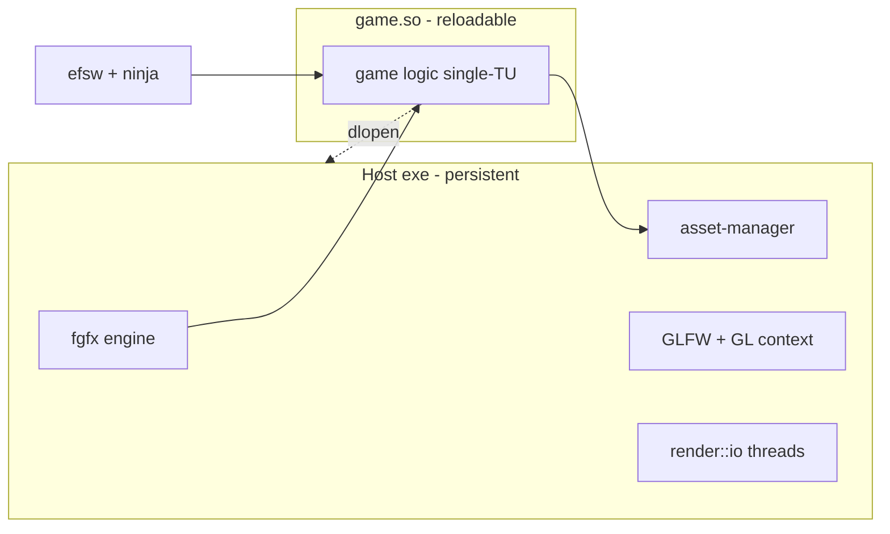
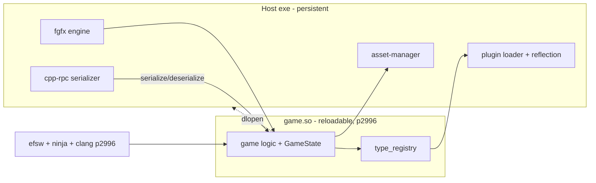
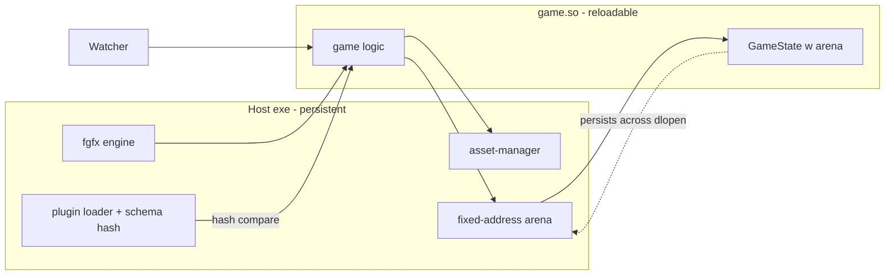
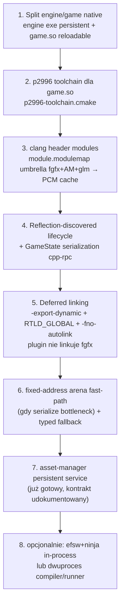
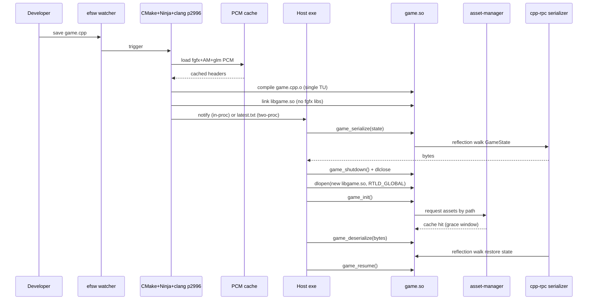

# Propozycje rozwiązań — architektura hotswap

Spektrum pomysłów konserwatywnych → kreatywnych (native only), potem 3 alternatywne architektury z trade-offami, potem rekomendacja. Hotswap **tylko natywnie (GLFW/Linux = dev path)**; web out of scope.

---

## Spektrum pomysłów (krótkie notki, native only)

Spektrum od najprostszego do najbardziej kreatywnego. Każdy pomysł = inkrementalny dodatek do poprzedniego.

1. **CppCad2-clone**: `dlopen` `game.so`, hardcoded `extern "C"` lifecycle (`game_init/update/render/shutdown`), brak migracji stanu. Najprostsze, działa od razu.

2. **+ clang header modules** dla fgfx/asset-manager/glm headers (`module.modulemap` umbrella → PCM cache). To daje ~1s zamiast ~10s.

3. **+ reflection-discovered interface** (p2996) zamiast hardcoded mangled symboli. Host auto-discover `update/render/serialize/deserialize` przez type_registry. Eliminuje `_Z13renderProjectv` anty-pattern.

4. **+ typed state migration** przez cpp-rpc serialize/deserialize (`GameState` struct). Reload = serialize → unload → load → deserialize. Stan przetrwa.

5. **+ raw memory fast-path**: fixed-address arena allocowana przez host (nie w `.so`), `dlopen` zachowuje wskaźniki gdy layout stabilny. Zero-cost dla same-layout patches.

6. **+ event-sourced / pure-function `update(dt, state) -> state`** dla testowalnej części logiki. Bonus: record/replay dla regression test gameplay zmian, determinism.

7. **+ schema migration auto-generowana** z reflection (field-name matching między wersjami). Layout change → automatyczna migracja zamiast crash.

8. **+ live struct editing / inspekcja** przez type_registry (module-debugger-style UI, native). Podgląd GameState, callowanie API w trakcie dev.

9. **+ dwuprocesowy compiler/runner** (InrementalCpp-style) vs in-process watcher — wybór orchestration. Compiler daemon rebuild, runner reload — albo wszystko in-process jak CppCad2.

---

## Alternatywne architektury (native only)

### Architektura A — "CppCad2++ minimal"

Najprostsza. Engine exe + reloadable `game.so`, brak migracji stanu.

**Struktura:**
- **Host exe**: fgfx (static lib) + asset-manager + GLFW + `render::io` + `main()` z main loop
- **`game.so`**: kod gry, single-TU, linkowany z clang header modules (PCM)
- **Lifecycle**: `extern "C" game_init()`, `game_update(double time, float delta)`, `game_render()`, `game_shutdown()`

**Build:**
- Host: `-Wl,-export-dynamic`, linkuje fgfx/GLFW/GLEW/png
- Plugin: `dlopen(RTLD_GLOBAL)`, `-fno-autolink`, nie linkuje fgfx (symbole z hosta), `module.modulemap` umbrella dla fgfx headers
- Compile: efsw watcher → CMake+Ninja → `libgame.so` (jak CppCad2 `ProjectDir`)

**State:** reconstruct — asset-manager cache + re-run `game_init`. Gra **traci** stan entity przy reload.

**Trade-off:**
- (+) najprostszy, najszybszy start
- (+) działa bez p2996 toolchainu (stock clang + header modules wystarczą)
- (-) gra traci stan — OK dla tuning stałych, **słabe** dla długich sesji gameplay
- (-) hardcoded `extern "C"` lifecycle (mniej złe niż mangled, ale wciąż manual)

**Kiedy:** prototyp, proof-of-concept, gdy stany są cheap do reconstruct.



---

### Architektura B — "Reflection-driven plugin + typed state migration"

Pełna moc. p2996 reflection dla interface discovery + state migration.

**Struktura:**
- **Host exe**: jak A, ale linkuje cpp-rpc serialization
- **`game.so`**: kod gry kompilowany z `p2996-toolchain.cmake` (clang p2996 fork)
- **Interface**: game plugin expose API via p2996 — type_registry / `rpc_description`-style. Host auto-discover `update/render/serialize/deserialize` przez reflection, nie hardcoded nazwy.

**GameState:**
```cpp
// w game.so
struct [[=serialization::message()]] GameState {
  float playerX, playerY;
  int score;
  std::vector<Entity> entities;
  // ...
};

extern "C" void game_init();
extern "C" void game_update(double time, float delta);
extern "C" void game_serialize(/* writer */);
extern "C" void game_deserialize(/* reader */);
```

Albo via reflection — host czyta type_registry z pluginu, znajduje `GameState`, serializuje.

**Reload sequence:**
1. `game_serialize(state)` → bytes (cpp-rpc, reflection walk)
2. `game_shutdown()`
3. `dlclose(game.so)`
4. `dlopen(new game.so)` (RTLD_GLOBAL)
5. `game_init()` (re-request assets via manager — cache hit)
6. `game_deserialize(bytes)` → restore state

**Schema hash:** type_registry zawiera layout info. Hash porównany old vs new. Jeśli się zmienił → opcjonalna migracja (field-name matching) albo warning.

**module-debugger integration:** opcjonalnie — host expose GameState przez ten sam `rpc_description` mechanizm, podłącz module-debugger (lub native port) do inspekcji/call mid-reload.

**Trade-off:**
- (+) pełna moc, stan przetrwa
- (+) version-tolerant (schema hash + migracja)
- (+) debuggable (reflection → inspect)
- (+) eliminuje hardcoded symboli (reflection discovery)
- (-) wymaga p2996 toolchainu w game-dev (zmiana buildu)
- (-) serialize/deserialize overhead (~ms, akceptowalne)
- (-) schema compat discipline — każde GameState change = świadomy
- (-) więcej moving parts (type_registry, serializer wiring)

**Kiedy:** gdy stan gry jest expensive do reconstruct, długie sesje gameplay, chcemy debug inspekcję.



---

### Architektura C — "Hybryda: raw memory fast-path + typed fallback"

Najszybszy. Stan gry w fixed-address arena, zero-cost gdy layout stabilny, typed fallback gdy się zmienia.

**Struktura:**
- **Host exe**: jak B, + arena allocator
- **`game.so`**: kod gry, GameState alokowane z **host-provided arena** (nie `malloc` w `.so`)
- **Arena**: fixed-address memory region owned by host, persists przez `dlclose`/`dlopen`

**Same-layout reload (fast-path):**
1. Schema hash old == new (z type_registry)
2. `game_shutdown()` (ale **nie** free arena)
3. `dlclose` → `dlopen`
4. `game_init(arena_ptr)` — wskaźniki do GameState wciąż ważne (arena nie ruszona)
5. Zero-cost, natychmiast

**Layout-change reload (typed fallback):**
1. Schema hash old != new
2. `game_serialize(state)` → bytes (stary layout)
3. `dlclose` → `dlopen`
4. `game_init(fresh_arena)`
5. `game_deserialize(bytes)` → nowy layout (z migracją field-name)

**Dyscyplina:**
- Game code alokuje GameState z arena (custom allocator), nie `malloc`
- Brak raw pointers do stack/local w GameState (po reload invalid)
- `shared_ptr`/vtable w GameState = zabronione (layout-stability)
- GameState = POD-ish + collections z arena-aware allocator

**Trade-off:**
- (+) najszybszy przy stabilnym layoucie (większość iteracji: tuning stałych, zmiana wzorów — layout się nie zmienia)
- (+) bezpieczny przy layout change (typed fallback)
- (+) best of both worlds
- (-) złożony (arena allocator, schema hash, dwie ścieżki)
- (-) dyscyplina alokacji (no malloc w `.so` dla stanu) — łatwo złamać
- (-) ryzyko raw-memory bugów jeśli dyscyplina zawiedzie
- (-) vtable/shared_ptr w GameState zabronione — ogranicza expressiveness

**Kiedy:** gdy ~1s serialize/deserialize jest za wolny (np. bardzo duży GameState), większość iteracji to layout-stable zmiany, zespół dotrzyma dyscyplinę alokacji.



---

## Rekomendacja

**Architektura B jako baza + elementy C (fixed-address arena fast-path) + spectrum pomysł 6 (pure update dla testowalnej części).**

### Dlaczego B jako baza

- Stan gry musi przetrwać reload (wymaganie) → potrzebna migracja → B to minimum
- p2996 reflection mamy w repo (cpp-rpc) → naturalne wykorzystanie
- Eliminuje hardcoded symboli (anty-pattern CppCad2)
- Version-tolerant — schema hash + migracja chroni przed crash przy layout change
- Debuggable — reflection → inspekcja GameState (dev UX)

### Dlaczego elementy C (fast-path)

- Większość iteracji dev to **layout-stable** zmiany (tuning stałej, zmiana wzoru, ajustowanie feel) — schema hash się nie zmienia
- Dla tych ~90% zmian, serialize/deserialize = zbędny overhead
- Fast-path (arena persists, zero-cost) daje natychmiastowy reload dla common case
- Typed fallback (B) daje bezpieczeństwo dla ~10% layout-changing reloads
- **Ale**: arena dyscyplina to koszt — włączyć **gdy** serialize overhead okaże się bottleneck, nie od razu. Zacząć od B czystego, dodać C gdy zmierzymy.

### Dlaczego elementy spectrum 6 (pure update)

- Opcjonalne dla **testowalnej części** logiki (gameplay rules, AI decisions)
- `update(dt, state) -> state` pure function → record/replay → regression test czy zmiana nie zepsuła gameplay
- Nie wymuszaj na całej grze — tylko tam gdzie chce się determinism + test
- Bonus: introspekcja przez module-debugger pattern

### Plan implementacji (8 kroków)



1. **Split engine/game native**: engine exe (fgfx+asset-manager+GLFW persistent) + `game.so` reloadable. Dziś monolityczny — wydzielić game code do osobnego targetu.

2. **p2996 toolchain** (`p2996-toolchain.cmake`) dla `game.so`. Host może zostać na stock clang (nie potrzebuje reflection) — tylko plugin. Zmiana build config, nie rewrite.

3. **clang header modules**: `module.modulemap` umbrella dla fgfx+asset-manager+glm → PCM cache (`-fmodules -fcxx-modules -fmodules-cache-path -fmodule-map-file`). To daje ~1s. Wzorować się na CppCad2 `projects/home/src/`.

4. **Reflection-discovered lifecycle + GameState serialization** (cpp-rpc): `GameState` struct z `[[=serialization::message()]]`, host auto-discover `update/render/serialize/deserialize` przez type_registry. Eliminuje hardcoded symboli.

5. **`-export-dynamic` + `RTLD_GLOBAL` + `-fno-autolink`**: plugin nie linkuje fgfx (symbole z hosta). Link line `libgame.so` = tylko `game.cpp.o`. Wzorować się na CppCad2.

6. **fixed-address arena dla stanu** (fast-path) + typed fallback gdy schema hash się zmieni. **Włączyć gdy zmierzymy serialize overhead jako bottleneck** — nie od razu. Zacząć od czystego B.

7. **asset-manager jako persistent service** (już gotowy, kontrakt udokumentowany w README L22-32). Kod gry re-requestuje po reload → cache hit (grace window 120 frames) → natychmiast. Nie trzeba budować.

8. **Opcjonalnie: orchestration** — in-process efsw watcher + ninja (jak CppCad2 `ProjectDir`) albo dwuprocesowy compiler/runner (jak InrementalCpp). In-proc prostszy na start.

### End-to-end pipeline (native)



### Ryzyka i mitigacje

| Ryzyko | Mitigacja |
|--------|-----------|
| p2996 toolchain instability | host na stock clang, tylko plugin na p2996; izolacja |
| Arena dyscyplina złamana | zacznij od B (czysty typed), dodaj C gdy zmierzone |
| GameState schema drift | schema hash + migracja field-name (cpp-rpc type_registry) |
| vtable/shared_ptr przez boundary | GameState = POD-ish + collections, brak vtable w stanie |
| Thread leak w plugin | `game_shutdown()` musi joinować; audit + lint |
| Compile error crash hosta | build error → nie reload, pokaż komunikat, kontynuuj na old `.so` |
| Symbol clash RTLD_GLOBAL | namespace isolation, `-fno-autolink`, audit exports |

### Co nie jest w tym planie (out of scope)

- Web hotswap (Emscripten) — pełny rebuild OK tam
- Production shipped hot-reload — tylko dev
- Screenshot regression tests — visual QA manual
- Generic plugin system dla third-party — tylko nasza gra
- Multiplayer state sync przez reload — osobny problem

---

## Otwarte pytania do decyzji

1. **Czysty B na start, czy B+C od razu?** Rekomendacja: czysty B, dodać C po zmierzeniu serialize overhead.
2. **In-proc watcher vs dwuproces?** Rekomendacja: in-proc na start (prostsze), dwuproces jeśli kompilacja blokuje main loop.
3. **GameState jako jeden struct czy graf obiektów?** Rekomendacja: jeden root `GameState` struct z zagnieżdżonymi kolekcjami; entity jako value types w wektorze, nie `shared_ptr` graph.
4. **Czy włączyć p2996 dla całego game-dev, czy tylko `game.so`?** Rekomendacja: tylko `game.so` (izolacja ryzyka), host na stock clang.
5. **Czy module-debugger integration w v1?** Rekomendacja: nie, jako follow-up gdy core działa.

Po decyzji → implementacja wg 8 kroków.
