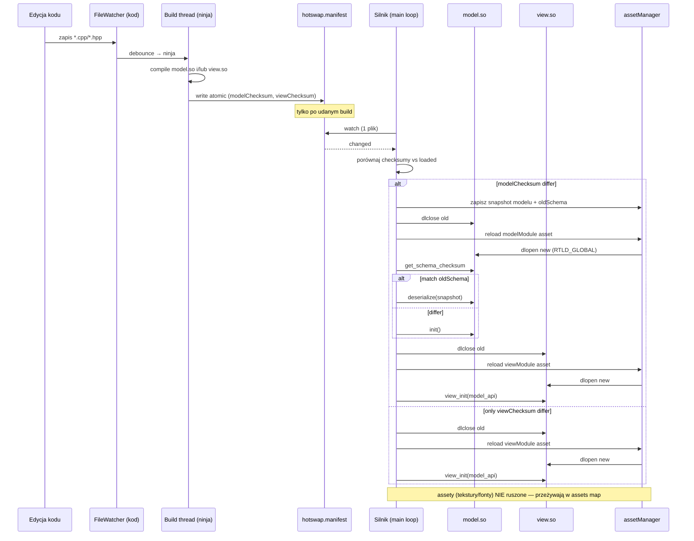
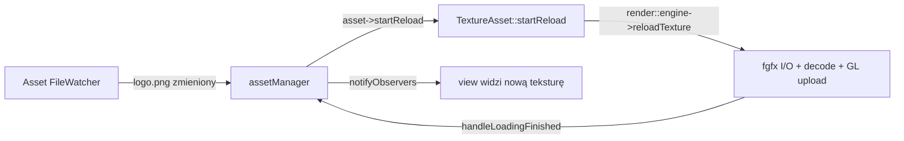

# Rozwiązanie — warstwowa architektura hotswap (Silnik / Model / Widok)

Wybrane rozwiązanie instant reload kodu gry, **tylko natywnie (GLFW/Linux = dev path)**; web out of scope. To rozwinięcie propozycji B z `propozycje-rozwiazan.md` z trzema zmianami względem niej:

1. **Warstwy jak w Fox2d** — Silnik (persistent) / Model (logika, serializowalny, multiplayer-runnable) / Widok (render, niemigrujący).
2. **Assety nie są reloadowane przy przeładowaniu kodu** — przeżywają reload kodu; reload assetu następuje tylko gdy **plik assetu się zmieni** (osobny watcher, osobna ścieżka).
3. **Atomowy reload przez manifest z checksumą** — filewatcher nie przeładowuje instant przy zmianie `.so` (race condition gdy oba się rekompilują). Build wystawia jeden plik manifestu z checksumami widoku i modelu; silnik watchuje tylko manifest i podejmuje decyzję w jednym miejscu.

Wszystkie ścieżki względem repo root.

---

## Przegląd warstw

| Warstwa | Co zawiera | Build artifact | Reload | Serializacja stanu |
|---------|-----------|----------------|--------|---------------------|
| **Silnik** (exe, persistent) | fgfx, asset-manager, `asset_manager_fgfx` (typy assetów), `asset_manager_ui` (loading/error screen), render::io, input, filewatcher, build orchestrator | executable | nigdy | nie |
| **Model** | logika gry, fizyka, entity state, gameplay rules, multiplayer-runnable (headless) | `model.so` | gdy checksum modelu się zmieni → reload **model + widok** | **tak**, pełna |
| **Widok** | renderowanie, read modelu per-frame, efekty wizualne (cząsteczki), camera | `view.so` | gdy checksum widoku się zmieni → reload **tylko widok** | nie |

Reguła "model change → reload model + widok" rozwiązuje ABI: widok jest rekompilowany z nowymi nagłówkami modelu, więc widzi nowy layout stanu. Granica Silnik↔Model musi być stabilna przez reload (silnik persistent) — rozwiązana stylem CppCad2 (sekcja niżej).

---

## Atomowy reload przez manifest (kluczowe)

### Problem race condition

Naiwne podejście: filewatcher na `view.so` i `model.so` → instant reload przy każdej zmianie. **Złe**, bo gdy edytujesz plik dotykający i modelu i widoku (np. wspólny header `GameState.hpp`), oba `.so` się rekompilują. Jeśli watcher odpali reload po skończeniu pierwszego `.so` zanim drugi skończy, silnik wczyta **niezgodne wersje** (stary model + nowy widok, lub odwrotnie) → crash / garbage.

### Rozwiązanie: jeden manifest, jeden punkt decyzyjny

Build system (ninja) kompiluje `view.so` i/lub `model.so`. Po **udanej** pełnej rekompilacji, post-build step wystawia plik manifestu, np. `build/hotswap.manifest`:

```json
{
  "modelChecksum": "<sha256(model.so)>",
  "viewChecksum":  "<sha256(view.so)>",
  "builtAt":       "<unix-ms>"
}
```

Manifest zapisywany **atomicznie**: write do `hotswap.manifest.tmp` + `rename()` (atomic na POSIX). Nie zostaje wystawiony jeśli build się nie udał → silnik nie przeładuje do zepsutej wersji.

Silnik watchuje **tylko** `hotswap.manifest` (jeden plik), nie poszczególne `.so`. Po zmianie manifestu, w jednym miejscu:

```
newModel = manifest.modelChecksum
newView  = manifest.viewChecksum
oldModel = loadedManifest.modelChecksum
oldView  = loadedManifest.viewChecksum

if newModel == oldModel and newView == oldView:
    # spurious, zignoruj
    pass
elif newModel != oldModel:
    reload_model_and_view()   # model się zmienił → oba
elif newView != oldView:
    reload_view_only()        # tylko widok
```

To eliminuje race: manifest jest wystawiony dopiero gdy **oba** `.so` są skończone i zlinkowane, więc silnik nigdy nie widzi half-written `.so` ani niezgodnej pary. Failed build = brak manifestu = brak reloadu (działa na starej wersji).

### Build orchestrator (wzór z CppCad2)

Wzór z [ProjectDir.cpp L51-108](game-dev/iterative/CppCad2/projectDir/ProjectDir.cpp): build thread z filewatcherem (`efsw`), debouncing zmian (`changeNumber` vs `buildNumber`), rerun CMake gdy `CMakeLists.txt` lub file list się zmieni, `ninja` dla inkrementalnej kompilacji, pomiar czasu. Tu dodajemy: po `ninja` sukcesie → compute checksumy → write manifest atomically. Silnik nasłuchuje na manifest, nie na `notifyObservers()` buildera.

Checksuma: najprościej `sha256` bajtów `.so`, albo nawet `mtime + size` jako tani identity. `sha256` bezpieczniejsze (build-in-place może nadpisać `.so` z tą samą mtime w edge case).

---

## Assety — osobna ścieżka, niezależna od kodu

### Zasada

**Reload kodu nie rusza assetów.** Assety przeżywają reload modelu i widoku — zostają w `assets` map ([AssetsManager.hpp L24](game-dev/asset-manager/src/AssetsManager.hpp)), requesty zostają. Reload assetu następuje **tylko** gdy plik assetu się zmieni (osobny watcher na katalog `assets/`).

### Mechanizm

Dwa niezależne watchery / dwie ścieżki:

1. **Watcher kodu** → build → manifest → reload `.so` (sekcja wyżej).
2. **Watcher assetów** → gdy `logo.png` / `font.fnt` / `level.json` się zmieni → `asset->startReload()` dla tego konkretnego assetu ([Asset.hpp L48](game-dev/asset-manager/src/Asset.hpp), `TextureAsset::startReload` [TextureAsset.cpp L30](game-dev/asset-manager/fgfx/TextureAsset.cpp)). Reszta assetów nietknięta.

To rozdziela dwie pętle iteracji: tweak kodu (~1s, bez I/O assetów) vs tweak assetu (reload tylko tego pliku, bez rekompilacji).

### Refcounting — odpowiedź na pytanie 5

Silnik trzyma assety **dopóki są potrzebne** (refcount-driven przez `AssetRequest`) **plus** `graceFrames=120` ([AssetsManager.hpp L29](game-dev/asset-manager/src/AssetsManager.hpp)) po ostatnim requeście. Mechanizm out-of-the-box:

- `manager.request<T>(name)` → `shared_ptr<AssetRequestT<T>>` + rejestracja w `liveRequests` + cancel eviction ([AssetsManager.hpp L40-53](game-dev/asset-manager/src/AssetsManager.hpp)).
- Ostatni `shared_ptr` umiera → `AssetRequestDeleter` → `onRequestDied` → evict po 120 frames.
- Heavy lifting (I/O, decode, GL upload) zawsze engine-side: `TextureAsset::startLoadingSelf` woła `render::engine->getTexture` ([TextureAsset.cpp L20](game-dev/asset-manager/fgfx/TextureAsset.cpp)), typy assetów żyją w `asset_manager_fgfx`.

**Co się dzieje przy reload widoku:**

1. `view.so` dropuje swoje `shared_ptr<AssetRequest>` (destruktory globali widoku).
2. `onRequestDied` → eviction queued za 120 frames.
3. `dlopen(new view.so)` → `view_init()` → re-request przez `manager.request<T>`.
4. `getOrCreateAsset` → **cache hit** (asset wciąż w `assets` map, grace 120 > reload ~60 frames) → natychmiast, bez I/O.
5. `cancelPendingEviction` → asset zostaje.

**Assety nie są reloadowane** — grace window zapobiega evict podczas reload. `AssetRequest` i `AssetRequestDeleter` żyją engine-side (non-template, [AssetRequest.hpp L49-52](game-dev/asset-manager/src/AssetRequest.hpp)), więc `dlclose(view.so)` nie invaliduje deletera. Refcount atomic w control blocku alokowanym przez engine — bezpieczny przez granicę `.so`.

**Warunki:**
- Reload kodu < `graceFrames` (~1s ≈ 60 frames @ 60fps < 120). Spełnione.
- Silnik trzyma permanentne requesty dla **engine-owned** assetów (loading screen font `ui`, jego tekstury) — persistent, nigdy nie dropuje.
- Model/widok re-requestują w `init()` po reload (przechodzą przez asset needs, wołają `manager.request<T>`).

**Ograniczenie:** wszystkie **typy assetów** (`TextureAsset`, `MSDFFontAsset`, ...) muszą żyć engine-side. Model/widok tylko requestują i konsumują (`req->get()->texture`). Nie definiuj asset types w reloadable `.so` — tylko używaj engine-owych.

---

## Granica Silnik ↔ Model (odpowiedź na pytanie 2)

**Jak najprościej, stylem CppCad2.** Model kompiluje się z nagłówkami silnika (+ module map) i używa obiektów wystawionych przez silnik bezpośrednio. V-table zostaje po stronie silnika.

Wzór z [CppCad2/projects/home/src/CMakeLists.txt](game-dev/iterative/CppCad2/projects/home/src/CMakeLists.txt):

```cmake
add_compile_options(
    -fmodules -fcxx-modules
    -fmodules-cache-path=${CMAKE_BINARY_DIR}/clang-modules
    -fmodule-map-file=${CMAKE_SOURCE_DIR}/module.modulemap
    -fno-autolink
)
include_directories(${HEADERS_PATH})   # nagłówki silnika
add_library(model SHARED ${PROJECT_SOURCES})
```

- `HEADERS_PATH` = nagłówki silnika (fgfx, asset-manager, cpp-rpc type_registry).
- `module.modulemap` = clang modules dla fast recompile (PCM cache).
- `-fno-autolink` + `RTLD_GLOBAL` przy dlopen → symbole silnika resolve'owane do już-załadowanego executable (v-table, inline functions zostają engine-side).
- Model linkuje się z `-undefined dynamic_lookup` (Linux: SHARED bez llinkowania engine; macOS: explicit flag).

Skutek: model pisze `render::engine->getTexture(...)`, `manager.request<TextureAsset>(...)` jakby silnik był biblioteką — bez C ABI wrapperów, bez ręcznego `dlsym` per funkcję. Lifecycle modelu przez minimalny C ABI: `model_init`, `model_update`, `model_serialize`, `model_deserialize`, `model_get_type_info`, `model_destroy`. Reszta (asset API, fgfx API) przez v-table silnika.

To samo dla widoku (kompiluje się z nagłówkami silnika **i modelu** — dlatego model change wymusza reload widoku).

---

## Model ↔ Widok API (odpowiedź na pytanie 1)

Widok dostaje **stabilne, niemodyfikowane dalej snapshoty `GameState`**, ale jako **pointery** (nie zserializowane dane) dla wydajności. **Kiedy** widok dostaje model — to odpowiedzialność silnika, który nimi zarządza.

Flow per-frame (silnik orkiestruje):

```
engine frame:
  1. collect input → Input struct
  2. model_update(model_state, input, delta)   # model liczy nowy stan
  3. snapshot = model_snapshot(model_state)     # stabilny read-only pointer
  4. view_render(snapshot, engine_api, delta)   # widok czyta, renderuje
  5. release snapshot                            # silnik zwalnia gdy widok skończył
```

- Snapshot to **read-only pointer** do stanu modelu (lub copy-on-write snapshot jeśli model mutuje in-place). Widok go nie modyfikuje, nie serializuje — czyta.
- Stabilność: layout `GameState` może się zmienić przy reload modelu — ale wtedy reload obu (model + widok), widok rekompilowany z nowym `GameState.hpp`. W jednej sesji między reloadami layout jest stały → pointer bezpieczny.
- Silnik zarządza timingiem: snapshot żyje dokładnie jedną ramkę (od `model_update` do końca `view_render`). Widok nie trzyma pointera po ramce.

Alternatywa do rozważenia później: double-buffering (model pisze do bufora B gdy widok czyta bufor A) gdy pojawią się wątki. Na razie single-threaded, niepotrzebne.

---

## Threading (odpowiedź na pytanie 3)

**Model nie ma żadnego threada.** Thready ma silnik. Najprostsza opcja:

- Silnik: main thread (GLFW main loop) + build thread (filewatcher + ninja, wzór [ProjectDir.cpp L21](game-dev/iterative/CppCad2/projectDir/ProjectDir.cpp)) + asset I/O threads (`render::io::init`, [FileLoader.cpp](game-dev/fgfx/src/io/FileLoader.cpp)).
- Per frame na main thread: `model_update` → `model_snapshot` → `view_render`. Sekwencyjnie, bez wątków w modelu.
- Optymalizacje (model na osobnym threadzie, double-buffering, job system) — później, gdy profilowanie pokaże bottleneck.

To trzyma MVP proste i eliminuje całą kategorię bugów sync model↔widok.

---

## Input (odpowiedź na pytanie 4)

Input obsługiwany przez **silnik** (GLFW callbacks) i idzie jako **spójna struktura `Input`** do modelu w momencie gdy model ma wyliczyć kolejną klatkę.

```cpp
struct Input {
  // keys, mouse, gamepad — spójny snapshot stanu wejścia w tej ramce
  std::bitset<KEY_COUNT> keys;
  glm::vec2 mousePos;
  glm::vec2 mouseDelta;
  // ...
};

// engine per frame:
Input input = collectInputFromGlfw();
model_update(model_state, input, delta);
```

- Silnik zbiera GLFW events → buduje `Input` raz na ramkę → przekazuje do `model_update`.
- Model nie zna GLFW — dostaje czystą strukturę. Headless-portable (serwer multiplayer buduje `Input` z network packets).
- `Input` jest engine-side (persistent header), stabilna przez reload modelu — bo to interfejs silnik→model.

---

## Type info, schema hash, reset vs deserialize

Model wystawia type info (jak `rpc_description` z cpp-rpc / wasm modules) — **nie po to żeby migrować**, ale żeby silnik wiedział czy **deserializować czy resetować**.

```cpp
// export model.so:
extern "C" const char* model_get_type_info();  // JSON/blob: schema + checksum
extern "C" const char* model_get_schema_checksum();  // prosty hash
```

Logika reload modelu:

1. Przed reload: silnik trzyma `serializedSnapshot` (bytes) + `oldSchemaChecksum`.
2. `dlclose(old model.so)` → `dlopen(new model.so)`.
3. `newSchemaChecksum = model_get_schema_checksum()`.
4. Porównaj:
   - **match** → `model_deserialize(serializedSnapshot)` — stan gry przetrwał reload.
   - **differ** → `model_init()` od zera — reset (gracz traci stan, ale to dev, OK).
5. **Manualny przycisk reset** w silniku → wymusza `model_init()` niezależnie od checksum.

To eliminuje hard problem auto-migracji (rename field, type change). Zamiast tego — reset. cpp-rpc machinery gotowe: `type_registry` + `type_description` budują schema compile-time.

---

## .so ładowane przez assetManager

Ładowanie `model.so` i `view.so` przez assetManager dla uniform error handling. Zarejestruj typ assetu `"nativeModule"` (lub dwa: `"modelModule"`, `"viewModule"`) przez `Asset::registerType` ([Asset.hpp L76-83](game-dev/asset-manager/src/Asset.hpp)). `startLoadingSelf()`:

- `dlopen(path, RTLD_GLOBAL)`.
- Na fail → `handleLoadingFailed()` z `dlerror()` w `error` ([Asset.hpp L45](game-dev/asset-manager/src/Asset.hpp)) → loading screen pokaże sensowny komunikat.
- Na success → `dlsym` lifecycle + `get_type_info`, `handleLoadingFinished()`.

Daje uniform path: brak `.so` / compile error / ABI mismatch → ten sam mechanizm co brak tekstury. Loading screen pokaże `model.so: file not found` zamiast crash. `startReload()` = `dlclose` + `dlopen` nowej wersji.

Zależność widok→model: widok jako asset zależy od modelu (`addDependency`, [Asset.hpp L63](game-dev/asset-manager/src/Asset.hpp)). Model ładuje się pierwszy. `LoadTask` już obsługuje dependency graph.

---

## Engine-owned loading / error rendering

Silnik renderuje **loading screen** i **stan błędu** (np. brak assetu, compile error modelu) — zastępuje renderer widoku w tym momencie. Jak wszystko gotowe → wraca do renderera widoku.

To już prawie działa: [LoadingScreen.cpp](game-dev/asset-manager/ui/LoadingScreen.cpp) żyje w `asset_manager_ui` (engine-side), ma własny `MSDFLayer`, `MSDFFont`, `PolygonLayer`. Wzór z [loading_screen_example.cpp L91-94](game-dev/asset-manager/examples/loading_screen_example.cpp):

```91:94:game-dev/asset-manager/examples/loading_screen_example.cpp
    if (!demo->showScene) {
      demo->screen->render(mvp);
      return;
    }
```

Silnik renderuje loading screen aż assety gotowe, potem oddaje do renderera widoku. Twoja propozycja to formalizuje: **engine-owned loading/error renderer** z **engine-owned assetami** (sprite, font, tekstury ładowane przez silnik, requestowane permanentnie).

To **nie łamie** kontraktu hot-reload (asset-manager README): kontrakt mówi że *game code* (reloadable) nie może trzymać raw payloadów przez reload. Silnik jest persistent — nigdy reloadowany — więc engine-owned loading UI + jego assety są w **właściwym miejscu**. To rozwiązuje napięcie flagowane w `problem.md`, nie tworzy nowego.

---

## Reload flow (Mermaid)



Asset reload (osobny watcher, niezależny):



---

## Plusy

1. **View-only reload = zero migracji stanu, zero ryzyka.** Większość iteracji (shader constant, particle color, camera, render layout) = view-only. ~1s reload, model nienaruszony. Główny win, najczęstszy case.
2. **Model state migration rzadsza i prostsza.** Type-info-for-reset eliminuje auto-migration hard problem — reset gdy schema hash differ, deserialize gdy match.
3. **Multiplayer za darmo.** Model headless-runnable (no view dep, input jako czysta struktura). Ładuj `model.so` na serwerze — jak Fox2d `processor/`.
4. **Atomowy reload przez manifest.** Zero race condition przy wspólnych headerach. Failed build = brak reloadu (działa na starej wersji).
5. **Assety przeżywają reload kodu.** Dwie niezależne pętle iteracji: tweak kodu bez I/O assetów, tweak assetu bez rekompilacji. Grace window 120 frames zapobiega evict.
6. **Engine-owned loading/error UI = clean.** Persistent silnik, własne assety, właściwe miejsce. Rozwiązuje napięcie z `problem.md`.
7. **Uniform error handling** przez assetManager dla `.so` (brak pliku, ABI mismatch → sensowny komunikat, nie crash).
8. **Refcounting out-of-the-box** — deleter engine-side, grace window zaprojektowane na ten case.
9. **CppCad2-style Engine-Model** — bez C ABI wrapperów per funkcja, v-table engine-side, model pisze `render::engine->...` naturalnie.
10. **Single-threaded MVP** — prosta orkiestracja (update → snapshot → render), brak bugów sync.

## Minusy / ryzyka

1. **Model↔View interface = największa praca.** `GameState` layout jako kontrakt. W jednej sesji stabilny (reload obu przy zmianie), ale trzeba zdefiniować co widok czyta. Snapshot-as-pointer wymaga dyscypliny (widok nie mutuje, nie trzyma po ramce).
2. **Dwa `.so` + manifest + dwa watchery** — więcej build complexity (dwa CMake targety, dwa PCM, post-build checksum, manifest). Zarządzalne ale więcej ruchomych części niż B.
3. **Snapshot lifetime.** Silnik musi zwolnić snapshot po `view_render`. Jeśli widok zcache'uje pointer → UAF po ramce. Mitigacja: clear contract + ew. debug-mode canary.
4. **Schema-hash reset = utrata stanu** przy każdej zmianie structu modelu. W dev OK, może irytować przy częstym tuningu pól. Manual reset button pokrywa świadomie.
5. **Asset używany tylko przez widok** — reload widoku → drop request → evict po 120 frames → reload z dysku przy next request. Wasteful. Mitigacja: engine warm-list lub wyższe `graceFrames` w dev build.
6. **Kod "pomiędzy"** (input, camera, UI) — musi mieć jasny dom. Reguła: input → engine, camera → view, UI → view/engine. Wymaga dyscypliny (lekcja z Fox2d).
7. **`-undefined dynamic_lookup` / `RTLD_GLOBAL` portability** — Linux OK, macOS wymaga flag (wzór [CppCad2 CMakeLists L37-41](game-dev/iterative/CppCad2/projects/home/src/CMakeLists.txt)). Web out of scope (OK).

---

## Plan implementacji (kroki)

1. **Silnik lifecycle + build orchestrator.** Przenieść `ProjectDir` (filewatcher + ninja + debouncing) z CppCad2 do silnika. Dodać post-build: compute checksumy `.so`, write `hotswap.manifest` atomically. Watcher na `hotswap.manifest` w main loop.
2. **CMake: targety `model.so` + `view.so`.** Dwa SHARED library z `-fmodules` + engine headers + module map (wzór CppCad2). `-fno-autolink`, `RTLD_GLOBAL` przy dlopen.
3. **`nativeModule` asset type w assetManager.** `Asset::registerType`, `startLoadingSelf` = `dlopen` + `dlsym`, `startReload` = `dlclose`+`dlopen`. Dependency widok→model. Error → `dlerror()` w `error`.
4. **Minimalny model.** `model_init/update/serialize/deserialize/get_schema_checksum/destroy`. Pusty `GameState` + jeden entity. Schema hash z cpp-rpc `type_registry`.
5. **Minimalny widok.** `view_init/render`. Czyta `GameState` snapshot (pointer), renderuje jeden sprite przez fgfx. `view_init` re-requestuje assety.
6. **Silnik orkiestracja per-frame.** `collectInput → model_update → model_snapshot → view_render → release snapshot`. Single-threaded.
7. **Reload logic z manifestem.** Porównanie checksum, dwa path (view-only / model+view), snapshot+schema-checksum przed reload modelu, deserialize-vs-reset, manual reset button (np. `R` key).
8. **Engine-owned loading/error UI.** Przenieść `LoadingScreen` z demo do engine flow: render gdy assety/code się ładują lub błąd. Engine-owned assety requestowane permanentnie.
9. **Asset watcher (osobny).** Watcher na `assets/` → `asset->startReload()` dla zmienionego pliku. Nie rusza kodu.
10. **Test.** Hot-reload widoku (zmień kolor sprite, ~1s, model nienaruszony). Hot-reload modelu (zmień regułę, reset gdy schema differ, migrate gdy match). Hot-reload assetu (podmień PNG, tekstura się odświeża bez rekompilacji). Race case (edytuj wspólny header, oba reload atomicnie spójnie). Failed build (stara wersja działa).

---

## Otwarte decyzje do potwierdzenia

- **Snapshot strategy:** read-only pointer do live `GameState` (model nie mutuje podczas render) vs copy-on-write snapshot. Rekomendacja na start: **read-only pointer + contract że model nie mutuje między `model_snapshot` a `view_render`** (single-threaded gwarantuje). COW gdy pojawią się wątki.
- **Checksuma:** `sha256(.so)` vs `mtime+size`. Rekomendacja: **sha256** (bezpieczne, małe `.so`).
- **Manifest format:** JSON vs prosty `modelChecksum\nviewChecksum\n`. Rekomendacja: **prosty text** (mniej zależności, łatwiejszy atomic write).
- **Reset button:** key (`R`) vs UI. Rekomendacja: **`R` key** na start, UI później.
- **Asset watcher scope:** cały `assets/` vs per-asset registration. Rekomendacja: ** cały katalog** + map path→asset.
